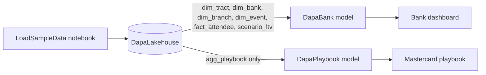

# DAPA Power BI dashboards on Microsoft Fabric

Skeleton for the DAPA dashboards described in `research-data/PROJECT_CONTEXT.md`. Everything here is a Fabric item definition, so a Fabric workspace connected to this folder through Git integration gets the lakehouse, notebook, semantic models and reports without anyone clicking them together.

**All data is synthetic sample data.** Tracts, banks, events and attendees are invented. Each table is replaced by its real pipeline later.

## What is in `workspace/`

| Item | Type | Purpose | Requirements |
|---|---|---|---|
| `DapaLakehouse.Lakehouse` | Lakehouse | Holds the gold Delta tables in the bank's tenant | F1, N1 |
| `LoadSampleData.Notebook` | Notebook | Builds the sample gold tables and the scored opportunity map | F2, F7, F8, N4, N5 |
| `DapaBank.SemanticModel` | Semantic model (Direct Lake) | Bank-tenant star schema and measures | F9, F11 |
| `DapaBank.Report` | Report | Bank dashboard: Opportunity Map, Pilot Results, Scenario: Cost vs LTV | F3, F9, F11, N6 |
| `DapaPlaybook.SemanticModel` | Semantic model (Direct Lake) | Reads only the de-identified aggregate | F10, N2 |
| `DapaPlaybook.Report` | Report | Mastercard playbook: What Worked, Where | F10 |

The `.pbip` files let Power BI Desktop open the same reports. Desktop is Windows only. On any other machine, edit the reports in the Fabric web editor.

## Data flow



| Table | Grain | Real source later |
|---|---|---|
| `dim_tract` | Census tract, with need, readiness, bank fit and opportunity scores | ACS 5-year, FDIC household survey, Inclusive Growth Score, business listings |
| `dim_bank`, `dim_branch` | Bank, branch | FDIC Summary of Deposits |
| `dim_event` | Community event | Event capture |
| `fact_attendee` | Registration, keyed by referral code | Registration, attendance, survey, bank outcomes (bank tenant only) |
| `scenario_ltv` | Scenario and year | Azure Machine Learning lifetime value model |
| `agg_playbook` | Area, product focus, event type, approach | Built from the tables above |

## Design rules the skeleton enforces

- **Opportunity score** is need × readiness × bank fit. Each part is a percentile rank, so no tract scores zero.
- **Place and need only.** No race, ethnicity or national-origin fields exist in either model. Language is kept for outreach planning and is not scored. A test fails if a protected-attribute column appears.
- **Opt-in matching.** Outcomes and survey scores are filled only for attendees who attended and consented. Everyone else has empty outcome fields.
- **Matched control.** The two tracts ranked just below the four pilot tracts get no events. The Pilot Results page compares new active accounts per 1,000 adults between pilot and control.
- **Assumptions are labeled.** Every lifetime value figure comes from `scenario_ltv`, whose `basis` column says `Assumption`. Its measures and visual titles say so too.
- **Mastercard sees aggregates only.** The playbook model contains one table with no referral codes, tracts, events or bank IDs. Groups under 10 attendees are dropped before the table is written. Change `MIN_GROUP_SIZE` in the notebook to adjust this.

## Deploy to a Fabric workspace

You need a Fabric capacity (trial is fine) and a workspace you administer.

1. In the workspace, open **Workspace settings > Git integration** and connect this repository. Set the branch and set the Git folder to `fabric/workspace`.
2. Choose **Sync** so the six items appear in the workspace.
3. Open **Load Sample Data**. Attach **DapaLakehouse** as the default lakehouse if it is not attached already, then choose **Run all**. It prints one line per table it writes.
4. Open **DapaLakehouse**, switch to its **SQL analytics endpoint** and open **Settings**. Copy the SQL connection string, which is the host name ending in `datawarehouse.fabric.microsoft.com`. Copy the endpoint ID, which is the GUID in the browser address bar while the endpoint is open.
5. In both `expressions.tmdl` files, replace `<SQL_ENDPOINT_HOST>` and `<SQL_ENDPOINT_ID>` with those two values. Land the change through a pull request, then choose **Update all** in the workspace's source control panel.
6. Open each semantic model's settings and confirm it can refresh, then open the two reports.

### Check on first open

- **Map visuals** use Azure Maps. A Fabric admin must enable the Azure Maps visual in the tenant settings. The latitude and longitude field wells were written by hand, so confirm both maps plot points. If not, drag `latitude` and `longitude` back into their wells and save.
- **Theme and layout** are defaults. Visual positions are a starting grid, not a design.

## Run the checks locally

Works on any machine with Python 3.10 or newer. Run from the repository root.

```bash
python3 -m venv .venv
source .venv/bin/activate        # Windows: .venv\Scripts\activate
pip install -r fabric/requirements-dev.txt
pytest fabric/tests
```

The tests run offline. They execute the notebook without Spark, which writes CSVs to a temporary `sample-output/` folder instead of the lakehouse. They check that:

- every definition file is valid JSON with a schema reference
- every report is bound to a model in this folder
- every field a visual uses exists in its model
- every relationship points at real columns
- model columns match what the notebook writes
- the playbook model holds only the suppressed aggregate
- no protected attributes appear, outcomes exist only for opted-in attendees, control tracts have no events, and lifetime value rows are labeled as assumptions

To preview the sample data, run the notebook as a plain script: open it in Jupyter or VS Code and run all cells. The CSVs land in `sample-output/`, which git ignores.

## Not in this skeleton

- Real ingestion pipelines for ACS, FDIC and the Inclusive Growth Score. The notebook is the stand-in.
- The research agent, Copilot Studio copilot and Dynamics 365 activation.
- Row-level security and sensitivity labels. In production, the playbook model and report belong in a separate Mastercard-facing workspace that receives only `agg_playbook`, never a shortcut to the bank lakehouse.
