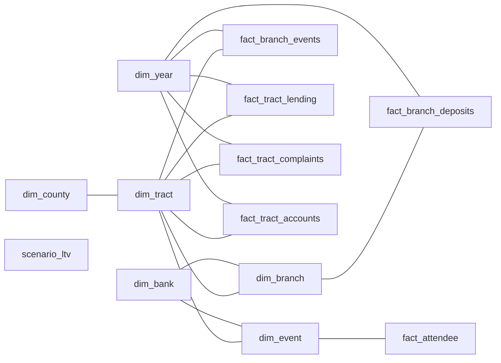

# DAPA Power BI dashboards on Microsoft Fabric

Skeleton for the DAPA dashboards described in `research-data/PROJECT_CONTEXT.md`. **It contains no data.** Every table is created empty with its final columns and join keys, and every chart is a labeled placeholder bound to the fields it will show. When the pipelines fill the tables, the charts light up without changes.

Everything here is a Fabric item definition, so a deploy or a Git-connected workspace gets the lakehouse, notebook, semantic models and reports without anyone clicking them together.

## See the layout in your terminal

No Azure or Fabric needed. Run from the repository root:

```bash
python3 fabric/tools/preview.py            # every page as a wireframe, then the data model
python3 fabric/tools/preview.py pages      # wireframes only
python3 fabric/tools/preview.py model      # tables, measures and links only
```

### See it as a web page

```bash
python3 fabric/tools/web_preview.py --open
```

This draws every page at Fabric's 1280 x 720 size, with each visual at its exact position and the same titles, text and empty states Fabric shows with no data. Hover a visual to see its type and bound fields. Only the Azure Maps background and the Segoe UI font differ outside Fabric. The file lands in `fabric/tools/out/`, which git ignores.

## What is in `workspace/`

| Item | Type | Purpose |
|---|---|---|
| `DapaLakehouse.Lakehouse` | Lakehouse | Holds the gold tables inside the bank's tenant |
| `CreateTables.Notebook` | Notebook | Creates every gold table empty. Never loads or overwrites data. |
| `LoadPublicData.Notebook` | Notebook | Fills the public-data tables for one metro from `data/processed/<sample>/` and `data/assumptions/`, and computes 5-year lifetime value per tract. Deployed only when `SAMPLE` is set in `config.env`. |
| `DapaBank.SemanticModel` | Semantic model (Direct Lake) | Bank-tenant star schema and measures |
| `DapaBank.Report` | Report | Bank dashboard, six pages |
| `DapaPlaybook.SemanticModel` | Semantic model (Direct Lake) | Reads only the de-identified aggregate |
| `DapaPlaybook.Report` | Report | Mastercard playbook, one page |

The `.pbip` files let Power BI Desktop open the same reports. Desktop is Windows only. On any other machine, use the Fabric web editor.

## Dashboard layout

The bank dashboard follows the solution's three stages, after a one-page summary. Each page opens with a banner that says what the page is for.

| Page | Stage | What goes there | Requirements |
|---|---|---|---|
| Overview | Summary | Headline cards led by active accounts, pilot vs control chart, later-phase scorecard note, Copilot panel | F9, F12 |
| Opportunity Map | Discover | County and pilot-arm slicers, tract map sized by opportunity score, branch overlay map, ranked tracts | F2, F3 |
| Community Evidence | Discover | Year slicer, unbanked estimate, mortgage denial and high-cost rates, banking-access complaints, branch closings vs openings | F1 |
| Branch Opportunities | Engage | Target local-bank branches with community evidence, deposits trend, pitch and campaign plan note | F6 |
| Pilot Results | Prove | Event funnel cards, pilot vs matched control, funnel rates by approach, results by event | F7, F8, F9 |
| Scenario: Cost vs LTV | Prove | Measured cost per active customer against labeled lifetime value ranges | F11, N6 |

The Mastercard playbook has one page, What Worked, Where. It shows results by area, product focus, event type and approach, from aggregates only (F10, N2).

Text boxes mark things that are not charts: the page banners, the Copilot Studio panel, the research agent's pitch output and the later-phase scorecard.

## Data model



The census tract (`tract_geoid`) is the hub. Every community fact joins to it, and one year table filters all yearly facts together. Links run one way, from each dimension to its facts. `scenario_ltv` stands alone because it holds assumptions, not observations. The playbook model holds a single table, `agg_playbook`.

## Where the data will plug in

| Table | Filled by | Collected source in `data/processed` |
|---|---|---|
| `dim_county` | Geography load | `sample_counties` |
| `dim_tract` | Scoring job | `acs_tracts` with `fdic_survey_rates` applied, plus scores |
| `dim_bank`, `dim_branch` | FDIC load | `institutions`, `branches` |
| `fact_branch_deposits`, `fact_branch_events` | FDIC load | `branch_deposits`, `branch_events` |
| `fact_tract_lending` | HMDA load | `hmda_tract_year` |
| `fact_tract_complaints` | CFPB load | `complaints_zip_year` through `zcta_tract` |
| `fact_tract_accounts`, `dim_event`, `fact_attendee` | Bank and event capture, bank tenant only | Not collected yet |
| `scenario_ltv` | Azure Machine Learning model | Not built yet |
| `agg_playbook` | Aggregation job with small-group suppression | Built from the event tables |

The column names in `CreateTables.Notebook` are the contract each pipeline writes to. The tests fail if a model drifts from them.

## Design rules the skeleton enforces

- **Place and need only.** No race, ethnicity or national-origin columns exist in any table. A test fails if one appears.
- **Opt-in matching.** Attendee outcomes are filled only for people who attended and consented.
- **Matched control.** The pilot pages compare new active accounts per 1,000 households between pilot and control tracts.
- **Assumptions are labeled.** Every lifetime value figure comes from `scenario_ltv`, and its measures and titles say so.
- **Mastercard sees aggregates only.** The playbook model has no referral codes, tracts, events or bank IDs. The aggregation job must drop groups under 10 attendees.

## Deploy

Follow [deploy/RUNBOOK.md](deploy/RUNBOOK.md). One command uses your Azure CLI sign-in to create a Fabric capacity in your resource group, a workspace, the empty tables, both models and both reports, then prints the report links.

**Alternative: Fabric Git integration.** Connect a workspace to this repository with the Git folder set to `fabric/workspace` and sync. Then run Create Tables. Fill the two `expressions.tmdl` placeholders with the lakehouse's SQL endpoint host and ID, and choose Update all.

### Check on first open

- **Map visuals** use Azure Maps. A Fabric admin must enable it in the tenant settings. The latitude and longitude field wells were written by hand, so confirm both maps plot points once data exists.
- **Branch events** count openings and closings by the labels `Opening` and `Closing`. Confirm these match the FDIC feed when that pipeline lands.

## Run the checks locally

Works on any machine with Python 3.10 or newer, from the repository root:

```bash
python3 -m venv .venv
source .venv/bin/activate        # Windows: .venv\Scripts\activate
pip install -r fabric/requirements-dev.txt
pytest fabric/tests
```

The tests run offline. They check that every visual's fields exist in its model and that model columns and types match the notebook. They check that every chart is labeled a placeholder and every page has a skeleton banner. They also check that the notebook never loads or overwrites data, that no protected attributes appear, that the playbook holds only the aggregate, and that the deploy script builds valid definitions.

## Not in this skeleton

- Any data, sample or real, and the pipelines that load it.
- The research agent, Copilot Studio copilot and Dynamics 365 activation. Their places are marked on the pages.
- Row-level security and sensitivity labels. In production, the playbook model and report belong in a separate Mastercard-facing workspace that receives only `agg_playbook`.
