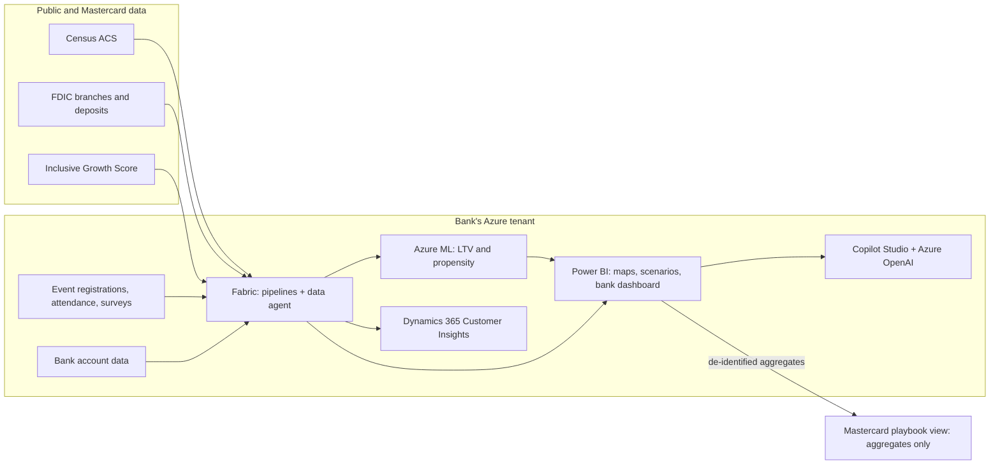

# DAPA: ROI Engine for Financial Inclusion

Project context for contributors. Read this first: it explains the problem, what the customer told us, the requirements, the architecture and the open questions.

| Field | Value |
|---|---|
| Customer | Mastercard, Financial Inclusion and Sustainability (Product & Strategy) |
| Program | Lead Aspire, Executive SOW track |
| Team | PromptPilots |
| Team role | Microsoft Cloud & AI specialists pairing the solution with Microsoft services |
| Status | SOW drafted (v1.0, 2026-10-12); prototype not yet built |

---

## 1. Problem

### 1.1 Background

Mastercard is more than a card network. Its Financial Inclusion and Sustainability team works to bring underserved, cash-reliant people into the financial system. These people pay rent and loans in cash, keep savings at home, and avoid banks because they do not trust them.

- Mastercard reports connecting 1.06 billion people to the digital economy since 2015, which beat its goal of 1 billion by 2025.
- Its 2026 proxy filing sets a new 2030 target of 500 million people and small businesses, shifting the focus from access to financial well-being. **The customer said "1 million" in Discovery. Confirm the number before using it externally.**

Mastercard does not serve end customers directly. It works through banks, which it calls **issuers**, located in areas with the most underserved residents. The target issuers are **smaller local banks**, not national banks such as Chase, Wells Fargo or Bank of America.

### 1.2 Current process

1. AI and census data identify neighborhoods with the most underserved residents.
2. Heat maps overlay those areas with bank branch locations.
3. Mastercard approaches the banks in those areas.
4. Mastercard and the bank decide what to offer (credit building, loans, financial education, fraud protection, small business information).
5. The bank buys campaigns to reach residents (cultural campaigns, A/B tests, spend-and-get offers, experiences). Mastercard offers this as a consulting engagement.

### 1.3 The actual friction

Discovery is not the bottleneck. **The bottleneck is convincing the bank.**

- Banks prioritize near-term profit and see low-balance, cash-reliant customers as costly.
- Mastercard's case rests on a claim: a customer's first bank becomes their bank for every later product (debit card, then credit card, then loans). Banks have no proof of this from their own market.
- Campaigns are the most expensive part of the engagement, and the bank pays for them.
- Mastercard **cannot rely on forecasts or assumptions** in front of a client. Outputs must be evidence-based.

### 1.4 Problem statement

> There are two trust gaps. The community does not trust banks, and banks do not trust that these customers will pay off. Mastercard needs a way to turn "they will be your customer for life" into measurable proof from the bank's own market, while helping banks earn the community's trust.

This is mainly a **psychological problem, not a technical one**. The technology exists to measure and prove what changes behavior.

---

## 2. Discovery evidence

### 2.1 From the customer conversation

| Signal | What the customer said (paraphrased) |
|---|---|
| Bottleneck | The hardest part is influencing the bank to focus on this population, not the data or the process. |
| ROI claim | Once in the system with a bank, people keep using that bank for every other product. |
| Evidence rule | We cannot really do forecasting or assumptions because we are talking to a client. |
| Cost | The most expensive piece is what the bank decides to buy (marketing campaigns). |
| Target banks | Not the traditional national banks; other banks deep in these areas. |
| Data | Census data refreshed every 4 to 5 years. (Correction: the Census Bureau's American Community Survey updates neighborhood-level estimates every year.) |
| Microsoft fit | The team must pair the solution with Microsoft services. |

### 2.2 From public research

**Why unbanked people say no (FDIC 2023 survey, US):**

| Reason | Share citing it | What is underneath | What fixes it |
|---|---|---|---|
| Can't meet minimum balance | ~42% (top reason) | Fear of losing money they can't afford to lose, like overdraft charges | No-minimum, no-overdraft accounts (Bank On certified) |
| Don't trust banks | ~36% | Discrimination history, surprise fees, bank collapses abroad | Trusted messengers, transparent fees |
| Privacy | ~34% | Fear of government, immigration, debt collectors, visibility of cash income | Alternative IDs accepted, plain-language data promise |
| Fees too high | ~31% | Unpredictable costs | Fee caps, real-time balance alerts |

Percentages come from secondary coverage; confirm against the FDIC appendix tables.

**Other findings:**

- 5.6 million US households (4.2%) were unbanked in 2023.
- Globally, 79% of adults own an account (World Bank Global Findex 2025). The remaining gap is **usage, not ownership**.
- In India, 35% of account holders had inactive accounts in 2021, and distrust was a leading reason (Global Findex, CGAP).
- In Latin America and in Europe and Central Asia, about one in three unbanked adults said they don't trust the financial system.
- Standalone financial education classes have small effects that fade over time. Education works best built into the product at the moment it matters, in the person's language.
- Banks under $10B in assets are exempt from the federal debit swipe-fee cap, so the local issuers Mastercard targets earn more per debit transaction than national banks.
- Community Reinvestment Act (CRA) rules are in flux. An August 2026 OCC/FDIC proposal would narrow the retail services counted to credit, so credit products may earn more CRA credit than checking accounts. Do not lead with CRA.
- Mastercard already owns the **Inclusive Growth Score**, a neighborhood-level (census tract) index that blends public data with anonymized Mastercard transaction data.

---

## 3. Customer readiness and constraints

| Area | Signal | Design implication |
|---|---|---|
| AI comfort | Already uses AI and census data | Agents and copilots are acceptable |
| Forecast tolerance | Low; client outputs must be defensible | Lead with measured results; label any projection |
| Data custody | Mastercard does not deal with end customers; banks are wary of sharing data | Data stays in the bank's own Azure tenant |
| Bank capacity | Small issuers with limited marketing and IT | Package as a shared, preconfigured service |
| Oversight | Recommendations must be reviewed | Human approval on campaigns; no automated actions |

---

## 4. Solution overview

DAPA is an **ROI Engine** with three stages.

| Stage | What it does |
|---|---|
| **Discover** | A research agent compiles area briefs. Automated pipelines merge census, branch and Mastercard inclusion data into an opportunity map scored by **need × readiness to adopt × bank fit**. |
| **Engage** | Produces a tailored pitch and campaign plan per bank: which areas, which starter product, which event formats. |
| **Prove** | Measures every community event end to end (registration, attendance, surveys, downstream account opening and 90-day activity). A live dashboard shows the bank cost per active customer against lifetime value. An aggregated view shows Mastercard what worked, where. |

**Outcome:** the bank decides on evidence instead of a promise, Mastercard shortens its sales cycle with a repeatable playbook, and communities get outreach shaped by what already earned trust with people like them.

### 4.1 Product ladder (what the bank offers)

Trust and revenue grow together, which makes "customer for life" measurable.

1. No-overdraft debit account plus low-cost money transfers abroad (remittances)
2. Savings
3. Credit-builder product
4. Loans and small business products

Do not lead with credit. People who distrust banks rarely start there.

### 4.2 Example pilot design

- Area A: credit-builder product plus multilingual financial education.
- Area B: remittance-friendly accounts plus spend-and-get offers.
- **Required:** a matched control area with no outreach, so differences reflect the campaign and not the neighborhood.
- Success metrics agreed with the bank **before** launch.
- Duration: 90 days.

---

## 5. Requirements

### 5.1 Functional

| ID | Requirement |
|---|---|
| F1 | Ingest public data: ACS census data, FDIC branch and deposit data, Mastercard Inclusive Growth Score. |
| F2 | Score each neighborhood (census tract) on need, readiness to adopt and bank fit. |
| F3 | Render an opportunity map with branch overlays and scenario views. |
| F4 | Research agent drafts area briefs for human review. |
| F5 | Agent automates data cleaning and joins. |
| F6 | Generate a tailored pitch and campaign plan per bank from model outputs. |
| F7 | Capture event data: registration, attendance, survey responses, event type, activities, approach, location. |
| F8 | Link event attendance to account opening and 90-day activity inside the bank tenant (event referral codes, opt-in matching). |
| F9 | Bank dashboard, preconfigured per bank, with pilot metrics and targets. |
| F10 | Mastercard playbook view: aggregated results by event type, activity, approach and area across banks. |
| F11 | Scenario view: acquisition cost versus lifetime value over 5 years, shown as labeled ranges. |
| F12 | Copilot that answers "what worked, where and why," grounded in dashboard data with cited sources. |
| F13 | Segmentation and campaign execution once the bank's own data is connected (later phase). |

### 5.2 Non-functional

| ID | Requirement |
|---|---|
| N1 | Customer and attendee data stays in the bank's Azure tenant. Mastercard never takes custody of personal data. |
| N2 | Mastercard receives aggregated, de-identified metrics only; small groups are suppressed. |
| N3 | Least-privilege access via Microsoft Entra ID; encryption at rest and in transit. |
| N4 | Explicit opt-in consent at event registration and surveys. |
| N5 | No race or ethnicity in targeting or models; target by place and need (fair lending). |
| N6 | Projections are labeled as assumptions and replaced with actuals as pilot data arrives. |
| N7 | Human approval required for campaign recommendations. No automated credit decisions. |
| N8 | Copilot answers only from governed data and cites its sources. |

---

## 6. Data

### 6.1 Sources for choosing communities (all observed, no forecasting)

| Signal | Purpose | Source | Refresh |
|---|---|---|---|
| Unbanked and underbanked rates | Need | FDIC National Survey of Unbanked and Underbanked Households | Every 2 years |
| Low-income tracts, language spoken at home, share born abroad, smartphone and broadband access | Need, outreach language, readiness | Census American Community Survey (5-year estimates) | Yearly |
| Check cashers, payday lenders, pawn shops, money-transfer shops | Fees people already pay for financial services | Business listings | Varies |
| Inclusive Growth Score | Combined inclusion and growth index | Mastercard Center for Inclusive Growth | Varies |
| Cash intensity (ATM versus card use) | Cash reliance | Mastercard aggregated, anonymized data | To confirm |
| Branch locations, deposits, recent closures | Bank fit and presence | FDIC Summary of Deposits | Yearly |
| Small business density, remittance flows | Readiness and immediate value | Census, Mastercard | Varies |
| Trusted local institutions (Bank On coalitions, community groups, churches, employers) | Low-cost outreach channels | Bank On, local directories | Varies |

### 6.2 Event data (new)

| Entity | Key fields |
|---|---|
| Event | id, bank, area (tract), date, event type, activities, approach, host organization, language |
| Registration | event id, consented (y/n), referral code, channel |
| Attendance | event id, referral code, attended (y/n) |
| Survey | event id, referral code, trust score before and after, what worked, what didn't |
| Outcome (bank tenant only) | referral code, account opened, funded within 30 days, active at 90 days, products held |

Personal identifiers never leave the bank tenant. Only aggregates by event type, area and approach flow to the Mastercard view.

### 6.3 Bank selection and trust screen

| Bank type | Why it fits | Watch out for |
|---|---|---|
| Community banks under $10B | Local presence; higher debit interchange | Small budgets and IT |
| Credit unions | Member-owned, higher trust | Membership rules |
| Minority depository institutions | Trusted by the community | Need tech help |
| CDFI banks and credit unions | Built for this population | Limited capacity |
| Mission digital banks | Low cost to serve | Trust in digital-only |
| Global: mobile money, microfinance | Where accounts actually open | Currency risk, bank-failure history |

Screen before partnering, using public data: complaint volume relative to size (CFPB), regulator enforcement actions, reliance on overdraft fees, deposit insurance, Bank On certified account offered, fraud controls and app quality, and recent branch closures in the target area.

---

## 7. Tech stack

| Layer | Service | Role |
|---|---|---|
| Data | **Microsoft Fabric** (OneLake, pipelines, data agent) | Ingest, clean and join public and bank data in the bank tenant |
| Models | **Azure Machine Learning** | Lifetime value and propensity models, shown as labeled ranges |
| Insight | **Power BI** | Opportunity maps, scenario views, bank dashboard, Mastercard playbook |
| Agents | **Azure OpenAI in Microsoft Foundry** | Research agent and model behind the copilot |
| Copilot | **Copilot Studio** | Grounded Q&A over dashboard data |
| Activation | **Dynamics 365 Customer Insights** | Segmentation and campaign execution once bank data is connected |
| Identity and security | **Microsoft Entra ID**, encryption, data labeling | Least privilege and tenant boundary |

### 7.1 Architecture

---

## 8. Scope

| In scope (prototype) | Out of scope |
|---|---|
| Opportunity map for one pilot metro from public data | Connecting a real bank's customer data |
| Research agent drafting area briefs, with human review | Live campaign execution in Dynamics 365 (designed, not built) |
| Automated data pipeline in Fabric | Production models trained on real customer data |
| Event measurement model using labeled sample data | Markets outside the United States |
| Power BI bank dashboard and Mastercard playbook view | Credit decisions or underwriting |
| Copilot answering "what worked, where and why" | Targeting individuals by race or ethnicity |
| Acquisition cost versus lifetime value scenario view with labeled assumptions | Pricing or contracts between Mastercard and banks |

---

## 9. Success metrics

**Lead with active accounts, not opened accounts.** This matches Mastercard's shift from access to well-being.

| Scorecard | Metrics |
|---|---|
| **Bank (the money case)** | Cost per *active* customer, 12-month retention, revenue per active account, months to payback, products per customer at 12 and 24 months, deposit growth, fraud losses |
| **Community (the trust case)** | Registration to attendance to account conversion, funded within 30 days, active at 90 days, direct deposit set up, how fast deposits are withdrawn as cash (slower means more trust), dormancy, complaints, referrals, survey trust score before and after |
| **Mastercard** | People moved into active digital use, digital transaction volume, banks signed and renewed, cost per active person, event playbook coverage |
| **Prototype** | Copilot gives correct, sourced answers to standard questions; no personal data leaves the bank tenant |

---

## 10. Stakeholders

| Group | Role |
|---|---|
| Mastercard Financial Inclusion and Sustainability, Product & Strategy | Owns the problem and issuer relationships; pilot sponsor |
| Partner bank leaders (retail, marketing, branch) | Buy campaigns and use the dashboard; approve data access |
| Cash-reliant residents | Affected by the outcome |
| Community organizations | Host events, act as trusted messengers |
| Lead Aspire Managing Director | Approves the build |
| Microsoft architect and product experts | Architecture, security, responsible AI and product guidance (about four one-hour touchpoints) |

---

## 11. Risks

| Risk | Impact | Mitigation |
|---|---|---|
| Lifetime value read as speculation | High | Labeled ranges; lead with measured results; replace with actuals |
| Bank will not share data | High | Data stays in bank tenant; Mastercard sees aggregates only |
| Weak link from event to account | Medium | Referral codes and opt-in matching in the bank tenant |
| Small event samples | Medium | Pool similar events, report ranges, avoid over-claiming |
| Fair-lending exposure | High | Target by place and need; no protected traits; fairness review |
| Outreach seen as predatory | High | No-overdraft starter accounts, trusted community hosts |
| Scope creep across many services | Medium | Hold to Section 8 scope |
| Comparing two areas without a control | Medium | Matched control area with no outreach |

---

## 12. Decisions

| Decision | Reason |
|---|---|
| Frame the problem as bank buy-in, not discovery | The customer said discovery is not the hard part |
| Measure pilots instead of forecasting | Customer cannot present forecasts to clients |
| Keep data in the bank's Azure tenant | Removes the data custody objection |
| Measure community events, not only paid campaigns | The consumer barrier is trust, built in person |
| Target by place and need | Fair-lending rules |
| Start with no-overdraft accounts, not credit | Matches the top reasons people avoid banks |
| Build Fabric, Power BI and the copilot first; defer Dynamics 365 and real-data models | Keeps the prototype buildable |

---

## 13. Open questions

- Is the 2030 target 500 million (public filing) or another figure?
- Does Mastercard count someone as "digitized" when an account is opened or when it is active?
- Can banks access Mastercard's neighborhood-level cash-intensity data?
- Would Mastercard share risk with the bank, for example by co-funding the pilot?
- What have past bank campaigns cost, and what results did they show?

---

## 14. Glossary

| Term | Meaning |
|---|---|
| Issuer | A bank that issues Mastercard cards |
| Unbanked / underbanked | No bank account / has one but still relies on check cashers, payday lenders or money orders |
| LTV | Lifetime value: revenue a customer brings over time |
| CAC | Cost to acquire a customer |
| ACS | American Community Survey, the Census Bureau's yearly survey |
| Census tract | A small neighborhood-sized area used in census data |
| CRA | Community Reinvestment Act, which rewards banks for serving low- and moderate-income areas |
| CDFI | Community Development Financial Institution |
| MDI | Minority Depository Institution |
| Bank On | A national standard for low-cost, no-overdraft accounts |
| Remittance | Money sent to family in another country |
| Tenant | An organization's own isolated Azure environment |

---

## 15. Sources

- [Mastercard: Beyond one billion (July 2026)](https://www.mastercard.com/us/en/news-and-trends/press/2026/july/beyond-one-billion--inside-the-journey-to-a-more-inclusive-and-s.html)
- [Mastercard 2026 proxy filing](https://www.sec.gov/Archives/edgar/data/0001141391/000114139126000021/ma-20260427.htm)
- [Banking Dive: 2023 FDIC survey](https://www.bankingdive.com/news/underbanked-us-population-grows-fdic-survey-unbanked-households/732820/)
- [ABA Banking Journal: 2023 FDIC survey](https://bankingjournal.aba.com/2024/11/fdic-percentage-of-unbanked-households-dropped-slightly-in-2023)
- [FDIC 2023 appendix tables](https://fdic.gov/household-survey/2023-fdic-national-survey-unbanked-and-underbanked-households-appendix-tables)
- [Cleveland Fed: Unbanked in America](https://www.clevelandfed.org/publications/economic-commentary/ec-202207-unbanked-in-america-a-review-of-the-literature)
- [CGAP: Reading Findex with a consumer protection lens](https://www.cgap.org/blog/reading-findex-with-consumer-protection-lens)
- [World Bank: Global Findex 2025](https://www.worldbank.org/en/news/press-release/2025/07/16/mobile-phone-technology-powers-saving-surge-in-developing-economies)
- [Mastercard Inclusive Growth Score](https://www.mastercard.com/news/perspectives/2023/inclusive-growth-score-for-everyone-to-win-you-have-to-keep-score)
- [Federal Reserve: CRA rescission proposal (July 2025)](https://www.federalreserve.gov/newsevents/pressreleases/bcreg20250716a.htm)
- [Venable: 2026 CRA changes](https://www.venable.com/insights/publications/2026/08/significant-changes-to-community-reinvestment)
- [Kansas City Fed: Bank On accounts](https://www.kansascityfed.org/research/payments-system-research-briefings/has-access-to-bank-on-certified-accounts-helped-ease-financial-barriers-to-bank-account-ownership/)
- [St. Louis Fed: Bank On data hub](https://www.stlouisfed.org/community-development/bank-on-national-data-hub/about-data-hub)
